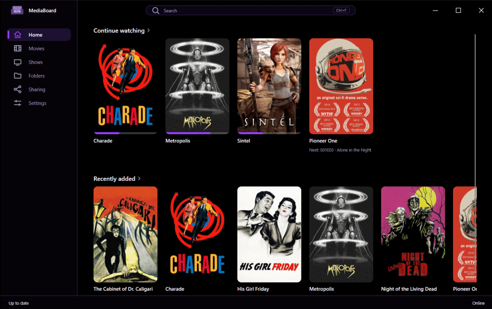
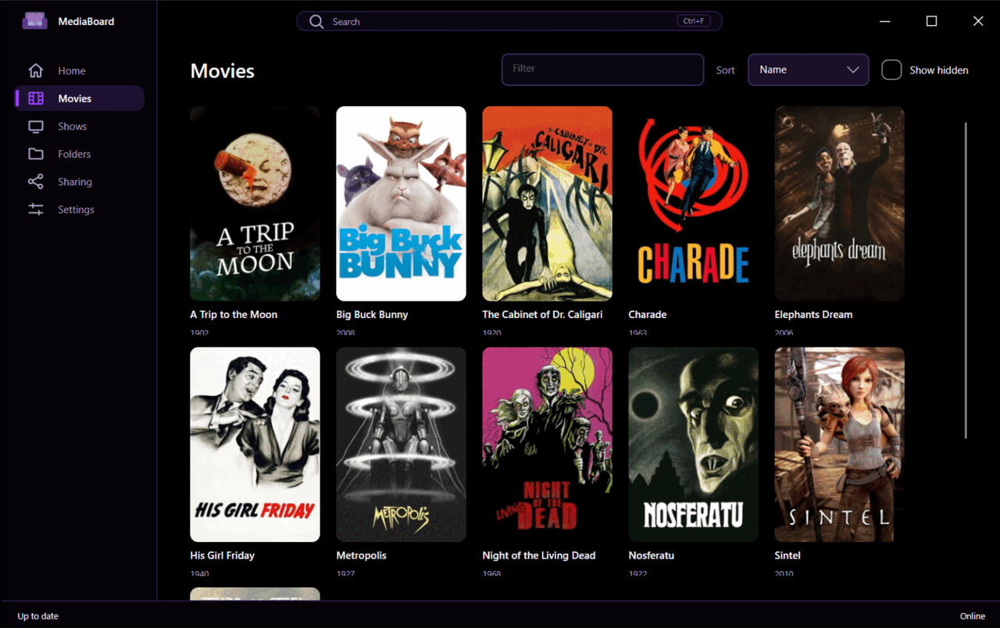
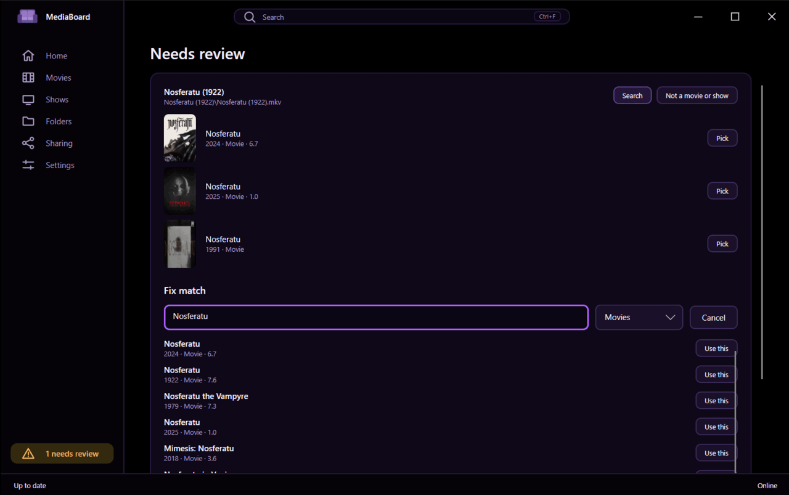
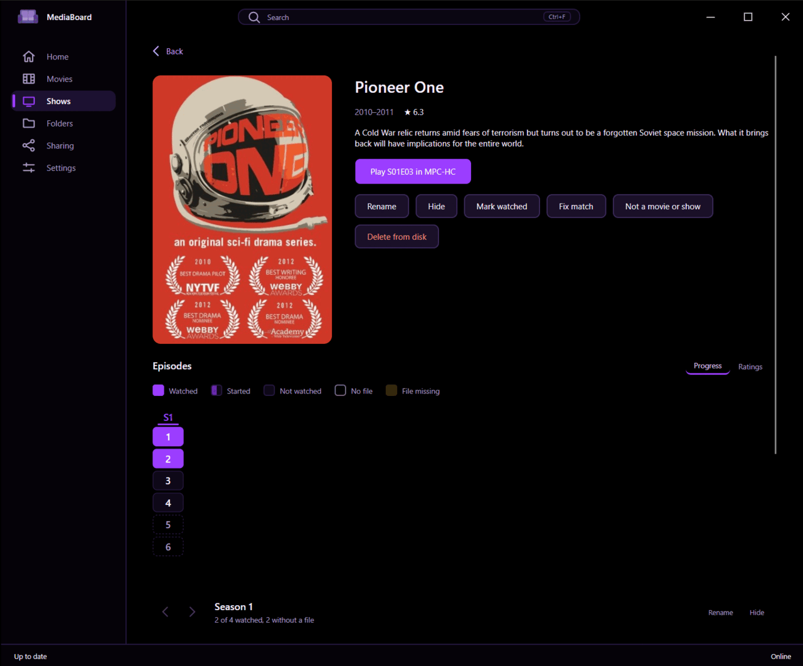

<h1 align="center">CozyCouch</h1>

<p align="center">Browse your own films and series on Windows and pick up where you stopped, in the player you already use.</p>

<p align="center">
  
</p>

CozyCouch finds the movies and series in your folders, fetches descriptions, posters and ratings from TMDB, and remembers
where you stopped. You play in MPC-HC, MPC-BE, mpv, VLC or any other program, and it keeps your progress from that player,
even when you opened the player yourself.

> [!NOTE]
> 0.1 beta. Works on Windows 11, in English.

## Why CozyCouch

- One desktop app that runs while you have it open. [Sharing](#sharing) is the one feature that needs it to keep running.
- Rename titles, hide them and fix matches in the app. The edits live in CozyCouch's database, so torrents keep seeding.
- It starts the player you already use and reads the position from it.
- Browsing, playback and progress work offline. Titles are identified when the connection returns.

CozyCouch is for a Windows PC that plays local files, with an option to let family watch from their own PC. To stream to
phones and TVs, use a media server such as Plex or Jellyfin.

## Quick start

Download `CozyCouch-0.1.0-beta-win-x64-setup.exe` from the [latest release](https://github.com/feluminais/CozyCouch/releases)
and run it. It needs no .NET and no administrator rights, and the release also has a zip you can unpack anywhere. The
installer is unsigned, so Windows SmartScreen warns once: choose **More info**, then **Run anyway**.

To run from source instead, you need the .NET 10 SDK:

```bash
git clone https://github.com/feluminais/CozyCouch
cd CozyCouch
dotnet run --project src/CozyCouch.Desktop
```

Then:

1. Open **Settings** and paste a free [TMDB API key](https://www.themoviedb.org/settings/api). The key switches on
   identification and online search, and the status bar tells you when it is missing.
2. Open **Folders** and add the folders that hold your media. Removing a folder removes its titles from the library.
3. Pick a player in **Settings**, or leave the detected one.

Building also keeps a CozyCouch shortcut on your desktop pointed at the latest build. Set `CozyCouchNoShortcut=true` to skip it.

<p align="center">
  
</p>

<p align="center"><sub>Screenshots use public-domain and Creative Commons films. Posters and descriptions come from TMDB.</sub></p>

## Players

CozyCouch detects MPC-HC, MPC-BE, mpv and VLC, lets you pick a default or browse to any `.exe`, and resumes from where you
stopped. It tracks position live in MPC-HC, MPC-BE, mpv and VLC, and launches any other program with
the file and asks whether you finished when it closes. A file counts as watched at 90% of its duration.

To record a player you started yourself, mpv needs one line in `mpv.conf` and the others need their web interface turned on.
Per-player details are in [docs/players.md](docs/players.md).

## Identification

CozyCouch reads the whole path, folder names included, and handles release noise, fansub names and episode ranges. A
`[tmdbid-123]` tag in a file or folder name is a certain match. Uncertain matches go to **Needs review** with
candidates and a search box, and your choice carries over to the other episodes in the same show folder. The full matching
rules are in [docs/identification.md](docs/identification.md).

<p align="center">
  
</p>

## Browse and search

- Home shows what you started, the next episode of what you finished, and what was added recently.
- `Ctrl+F` opens one search box over your library (instant, works offline) and over TMDB, so you can read the description and
  rating of a show outside your library. Type `>` for commands such as *Rescan library*.
- A show's page has an episode graph: its seasons as a grid, coloured by TMDB rating or by how far you got.
- Rename, hide, fix a wrong match, mark watched or unwatched.

<p align="center">
  
</p>

## Library

- The library rescans on startup and skips files whose size and modified time are unchanged. A file watcher picks up new,
  changed and removed files while the app is open.
- If a drive is unplugged or a file moves, the title keeps its progress and edits and recovers when the file returns. A file
  with the same name and size that turns up elsewhere in a library folder is relinked automatically.
- **Delete from disk** is a separate, explicit action. It names the files and sends them to the Recycle Bin.
- The status bar shows what the app is doing, such as scanning, identifying, offline or key missing. Each error in the
  activity panel says what to do.

## Sharing

Family can watch your library from their own PC. Sharing is off until you turn it on, the app must stay running (in the tray
is enough), and both sides run CozyCouch. Each person gets a one-time invite for the folders you choose, and their progress is
their own. The setup, ports and security details are in [docs/sharing.md](docs/sharing.md).

## Your data

Everything is under `%LOCALAPPDATA%\CozyCouch`: the SQLite library, cached posters and the settings file, including your TMDB key.

## Development

```bash
dotnet build
dotnet test --solution CozyCouch.sln -- --parallel none
```

`--parallel none` is needed because the headless Avalonia tests aren't reliable under default parallelism.
`scripts/Coverage.ps1` runs the tests with coverage and writes an HTML report to `coverage-report/`. Warnings are errors, and
the Meziantou analyzers run on every build.

The solution has three projects under `src/`, each with a test project in `tests/`:

| Project | Covers |
| --- | --- |
| `CozyCouch.Desktop` | The Avalonia app. |
| `CozyCouch.Core` | The UI-free core: scanning, parsing, identification, TMDB, storage, player adapters. |
| `CozyCouch.Server` | The ASP.NET Core server behind [Sharing](#sharing), which the desktop app hosts. |

The app reaches the library through an interface, so a shared library on another PC can stand in for the local one.

After a fresh clone, run `dotnet tool restore && dotnet husky install` once. The pre-commit hook scans staged changes for
secrets with [gitleaks](https://github.com/gitleaks/gitleaks) when it's installed. To point the app at a throwaway data folder,
for tests or screenshots, set the `COZYCOUCH_DATA_DIR` environment variable before starting it.

Bug reports and feature requests go to [Issues](https://github.com/feluminais/CozyCouch/issues).

## Licence

Copyright (C) 2026 feluminais. CozyCouch is free software under the [GNU General Public License v3.0](LICENSE). You may
use, change and share it, but a modified version you distribute must come with its source under the same licence.

## Credits

This product uses the TMDB API but is not endorsed or certified by TMDB. Metadata and images come from
[The Movie Database](https://www.themoviedb.org).
